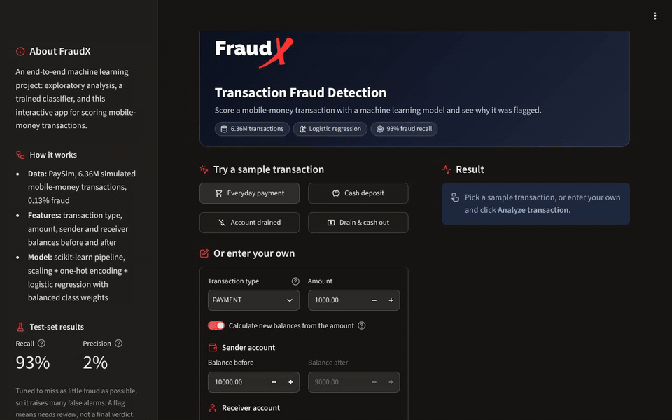
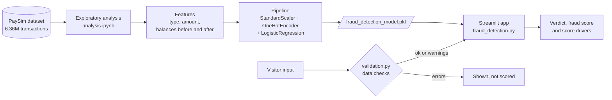
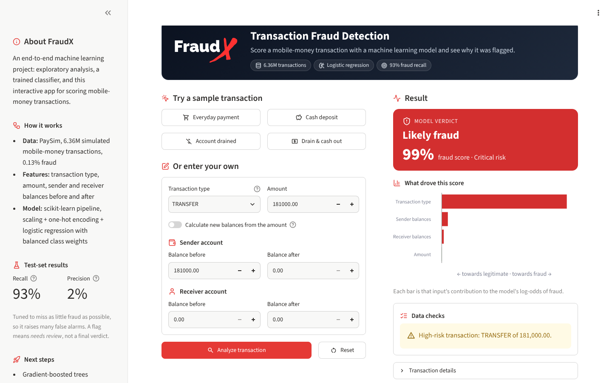

<p align="center">
  
</p>

<p align="center">
  <a href="https://fraudx-ml.streamlit.app"></a>
  <a href="https://github.com/chandhim/FraudX-ML/actions/workflows/tests.yml"></a>
  
  
  
  
</p>

<p align="center">
  <b>Score a mobile-money transaction, see the verdict, and see <i>why</i> the model decided it.</b><br>
  <a href="https://fraudx-ml.streamlit.app"><b>Open the live app</b></a> ·
  <a href="#how-it-works">How it works</a> ·
  <a href="#model-performance">Model performance</a> ·
  <a href="#run-it-locally">Run it locally</a>
</p>

<p align="center">
  
</p>

## Highlights

| | |
|---|---|
| **Simple input** | Enter a transaction type, amount and balances; new balances can be calculated from the amount automatically |
| **Explainable verdicts** | A chart of what pushed the score towards fraud or legitimate, taken directly from the model's weights |
| **Data checks** | Balances that don't add up are flagged, but still scored, because in this data they are a fraud signal |
| **Light and dark mode** | Follows the visitor's system theme, with a switcher in the menu |
| **Tested** | Unit tests for the validation rules and headless UI tests, run on every push by GitHub Actions |

## How it works



<details>
<summary><b>How the "what drove this score" chart is calculated</b></summary>
<br>

The model is a logistic regression, so its fraud score is a weighted sum of the (scaled) inputs passed through a sigmoid. Each input's contribution is its weight multiplied by its scaled value. The app groups these into four bars:

- **Transaction type**: the one-hot encoded type
- **Amount**
- **Sender balances**: balance before and after, added together
- **Receiver balances**: balance before and after, added together

The before and after balances of the same account are strongly correlated, so on their own their contributions are large and cancel each other out. Adding them together gives an honest picture of each account's overall effect.

</details>

<details>
<summary><b>About the data</b></summary>
<br>

[PaySim](https://www.kaggle.com/datasets/amanalisiddiqui/fraud-detection-dataset) simulates a month of mobile-money transactions based on real logs from a mobile money service. It has 6,362,620 transactions, of which 8,213 (0.13%) are fraud. Fraud only occurs in `TRANSFER` and `CASH_OUT` transactions, typically emptying the sender's account. The data is synthetic, so amounts are simulated units, not a real currency.

</details>

## Screenshots

<p align="center">
  <picture>
    <source media="(prefers-color-scheme: dark)" srcset="docs/images/app-dark.png">
    <source media="(prefers-color-scheme: light)" srcset="docs/images/app-light.png">
    
  </picture>
  <br>
  <sub>This screenshot follows your GitHub theme: switch GitHub between light and dark to see both versions of the app.</sub>
</p>

## Model performance

Results on a 30% stratified hold-out set (1,908,786 transactions, 2,464 of them fraud):

| Metric | Value | Meaning |
|---|---|---|
| **Recall (fraud)** | **93.3%** | Share of real fraud the model catches |
| **Precision (fraud)** | 2.2% | Share of flagged transactions that are really fraud |
| Accuracy | 94.6% | Not meaningful on its own: only 0.13% of transactions are fraud |

<details>
<summary><b>Confusion matrix</b></summary>
<br>

| | Predicted legitimate | Predicted fraud |
|---|---:|---:|
| **Actually legitimate** | 1,803,376 | 102,946 |
| **Actually fraud** | 165 | 2,299 |

</details>

> [!NOTE]
> The model uses balanced class weights, so it is tuned to miss as little fraud as possible. That comes at the cost of many false alarms, so a flag means *needs review*, not a final verdict.

### Roadmap

- [ ] Gradient-boosted trees (LightGBM / XGBoost)
- [ ] Balance-error features, e.g. `oldbalanceOrg - amount - newbalanceOrig`
- [ ] Decision threshold chosen from the precision–recall curve
- [ ] Time-based train/test split using the `step` column

## Run it locally

> [!IMPORTANT]
> Requires **Python 3.12 or newer** (needed by the pinned numpy, pandas and Streamlit versions).

```bash
git clone https://github.com/chandhim/FraudX-ML.git
```

```bash
cd FraudX-ML
```

<details>
<summary><b>macOS / Linux</b></summary>

```bash
python3 -m venv venv
```

```bash
source venv/bin/activate
```

</details>

<details>
<summary><b>Windows</b></summary>

```bash
python -m venv venv
```

```bash
venv\Scripts\activate
```

</details>

```bash
pip install -r requirements.txt
```

```bash
streamlit run fraud_detection.py
```

The app opens at http://localhost:8501. It uses the committed model, so you don't need the dataset.

<details>
<summary><b>Retrain the model with the notebook</b></summary>
<br>

1. Download the dataset from [Kaggle](https://www.kaggle.com/datasets/amanalisiddiqui/fraud-detection-dataset). You may need a Kaggle account.
2. Rename the CSV to `creditcard.csv` and put it in the project root. CSV files are git-ignored, so it won't be committed by accident.
3. Install the notebook dependencies:

   ```bash
   pip install -r requirements-dev.txt
   ```

4. Open the notebook and run the cells in order from the top:

   ```bash
   jupyter notebook analysis.ipynb
   ```

The last cell saves the pipeline to `fraud_detection_model.pkl`, overwriting the committed model. If you retrain with a different scikit-learn version, update the `scikit-learn` pin in `requirements.txt` to match.

</details>

<details>
<summary><b>Run the tests</b></summary>
<br>

```bash
pip install -r requirements-dev.txt
```

```bash
pytest
```

The suite covers the validation rules and drives the app headlessly with Streamlit's `AppTest`: typical legitimate and fraudulent transactions give the expected verdict, balances auto-calculate, results go stale when inputs change, Reset clears everything, and a zero amount is blocked.

</details>

<details>
<summary><b>Input checks</b></summary>
<br>

- **Errors** (negative values, a zero amount) stop the prediction.
- **Warnings** (balances that don't add up, a transfer or cash-out above 50,000) are shown, but the transaction is still scored. The 50,000 threshold is illustrative, since amounts are simulated units.

</details>

<details>
<summary><b>Troubleshooting</b></summary>
<br>

| Problem | Fix |
|---|---|
| `pip` can't find `scikit-learn==1.7.2` or `numpy==2.5.4` | Your Python is older than 3.12. Install 3.12+ and recreate the virtual environment. |
| `ModuleNotFoundError` | Activate the virtual environment and run `pip install -r requirements.txt`. |
| `InconsistentVersionWarning` when the model loads | Your scikit-learn version differs from the one that saved the model. Reinstall from `requirements.txt`. |
| Notebook can't find the dataset | The CSV must be named `creditcard.csv` and be in the project root. |
| Out of memory in the notebook | The dataset has 6.3M rows. Close other applications or use a machine with more RAM. |
| Port 8501 already in use | Add `--server.port 8502` to the `streamlit run` command. |

</details>

## Project structure

```
FraudX-ML/
├── fraud_detection.py         # Streamlit app
├── validation.py              # input checks used by the app
├── icons.py                   # Lucide icons (ISC license) used by the app
├── fraud_detection_model.pkl  # trained pipeline (scikit-learn 1.7.2)
├── analysis.ipynb             # exploratory analysis and model training
├── images/                    # FraudX logo (SVG and PNG)
├── docs/images/               # README banner, screenshots and animation
├── tests/                     # pytest suite
├── requirements.txt           # app dependencies (pinned)
├── requirements-dev.txt       # notebook and test dependencies
├── .github/workflows/         # CI: runs the tests on every push
└── .streamlit/config.toml     # light and dark themes
```

## Built with

Python · pandas · NumPy · scikit-learn · Streamlit · Plotly · Matplotlib · Seaborn · pytest · GitHub Actions

## Notes

- The model was trained with scikit-learn 1.7.2. Loading it with another version may warn or give wrong results.
- Only load `.pkl` model files you trust: unpickling can run arbitrary code.

## License and acknowledgments

- Dataset: [Fraud Detection Dataset on Kaggle](https://www.kaggle.com/datasets/amanalisiddiqui/fraud-detection-dataset), subject to its own terms.
- Icons: [Lucide](https://lucide.dev), ISC License.
